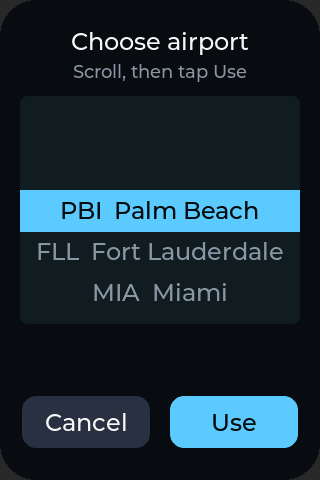
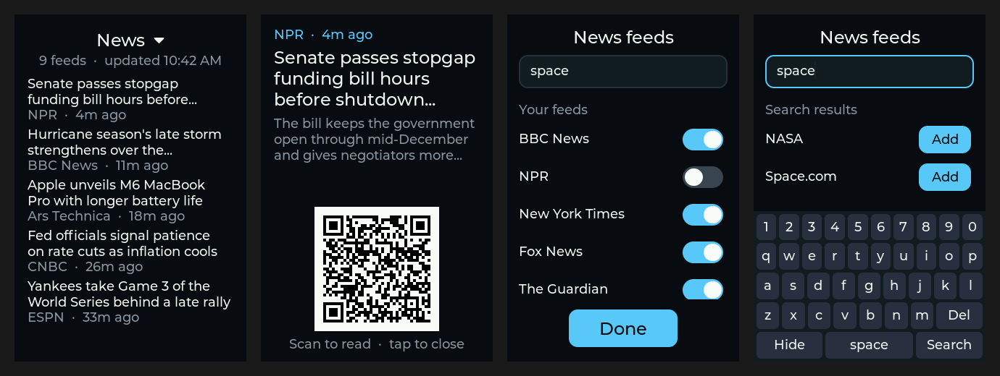
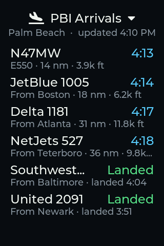

# DeskDash

DeskDash is a swipeable desk dashboard for the **[Waveshare ESP32-C5-Touch-LCD-3.5](https://www.waveshare.com/esp32-c5-touch-lcd-3.5.htm)**, a 320 × 480 touch display with an ESP32-C5 (dual-band Wi-Fi 6).


Every page is a **plugin**: a self-contained folder under `DeskDash/src/plugins/`. You turn pages on or off, or reorder them, by editing one list (see [Plugins](#plugins)).

| Plugin | Shows |
|---|---|
| `clock` | Time, date, Wi-Fi and battery status, indoor temperature and humidity, current weather |
| `weather` | Conditions, high/low, feels-like, humidity, wind, next 4 hours |
| `arrivals` | Flights arriving at your airport: airline and flight number, origin, distance, altitude and estimated arrival time |
| `departures` | Flights leaving your airport: taxiing out or climbing away, with destination and takeoff time |
| `news` | The latest headlines from RSS and Atom news feeds, with the source and how long ago each was posted. Tap a headline for its summary and a QR code that opens the article on your phone |
| `system` | Wi-Fi name, signal, IP, battery, indoor reading, uptime, last weather update, brightness slider |

Swipe left or right to change pages. On the Arrivals or Departures page, **tap the title to choose another airport**. The choice is saved on the board and applies to both pages.



On the News page, **tap a headline** to open it: you get the full headline, a short summary and a QR code. Scan the code with your phone's camera to read the article. Tap anywhere to go back; the card also closes by itself after 2 minutes so the pages keep cycling. **Tap the title to manage feeds**. Switch any feed on or off, or tap the search box to search for more by name or topic (for example "nasa" or "formula 1") with the on-screen keyboard, then tap **Add**. Feeds you added have an **x** to remove them. Your choices are saved on the board.



To prevent burn-in, the display moves to the next page every minute (`AUTO_CYCLE_SECONDS` in `config.h`, 0 turns it off). It waits while you are using the screen: any touch, or the airport picker being open, holds the current page for another minute. The screen dims between 10 PM and 7 AM, and a tap brightens it for 30 seconds.
Weather comes from [Open-Meteo](https://open-meteo.com), which is free and needs no API key. Time comes from NTP.

News comes straight from each publisher's RSS or Atom feed. The built-in feeds, all on until you switch them off, are BBC News, NPR, The New York Times, Fox News, The Guardian, CNBC, Ars Technica, ESPN and Hacker News. Each feed is re-read every 10 minutes (`RSS_REFRESH_MINUTES`). The page shows the 5 newest headlines across your feeds, at most 2 from any one source so a busy feed can't crowd out the rest. Feed search uses [Feedly](https://feedly.com)'s public search, which needs no account.
Live flight positions come from [adsb.fi](https://adsb.fi), a free community ADS-B network that needs no key, and are refreshed every minute. One request feeds both flight pages. Routes come from [adsb.lol](https://adsb.lol)'s route database, looked up once per callsign and at most every 10 minutes to stay inside its daily limit. A flight counts as an arrival when the route database says its route ends at the airport, and as a departure when its route starts there. Flights with no published route, such as private jets, are judged by their flight path: descending toward the field on a normal approach slope, or climbing away from it. Light aircraft and helicopters are left out, since most low traffic near an airport is flight training. Aircraft taxiing out show as "Taxi".

Arrivals are followed from one refresh to the next. When one touches down (seen on the ground at the airport, or lost from coverage while low and close on final, since receivers rarely see the runway) it stays on the Arrivals page as "Landed" with its landing time for `LANDED_KEEP_MINUTES` (30 by default).



## Hardware

- Waveshare ESP32-C5-Touch-LCD-3.5 (ST7796 display, FT6336 touch, CH32V006 I/O expander, AXP2101 power management, SHTC3 temperature/humidity sensor)
- A USB-C cable that carries data, plugged directly into the computer (not through a hub)
- Optional: a 3.7 V LiPo battery

## Setup (Arduino IDE)

1. **Board package:** install **esp32 by Espressif Systems**, version 3.3.x (Waveshare tests with 3.3.10).
2. **Library:** install **ArduinoJson 7.x** by Benoit Blanchon. LVGL 8.4 is bundled in `DeskDash/src/`, so it doesn't matter which lvgl version (if any) you have installed.
3. **Configure:** open `DeskDash/DeskDash.ino`, then set your Wi-Fi name and password, location, time zone, units, and default airport in the `config.h` tab. The Wi-Fi name is case-sensitive.
4. **Tools menu:**

   | Setting | Value |
   |---|---|
   | Board | ESP32C5 Dev Module |
   | USB CDC On Boot | Enabled |
   | Flash Size | 16MB (128Mb) |
   | Partition Scheme | 16M Flash (3MB APP/9.9MB FATFS) |
   | PSRAM | Enabled |
   | Port | `/dev/cu.usbmodem…` ("ESP32 Family Device") |

5. **Upload.** If the board isn't detected, hold **BOOT**, tap **RST**, and release **BOOT**.

Serial Monitor runs at 115200 baud. At boot the board scans for Wi-Fi networks and prints every network it can see, which helps track down a mistyped network name.

## Apple Silicon Macs

Arduino IDE's `ctags` helper is an Intel-only binary. If compiling fails with `bad CPU type in executable`, install Rosetta 2:

```
softwareupdate --install-rosetta --agree-to-license
```

## How it works

- **Display:** an ST7796 on SPI at 60 MHz, using `esp_lcd` panel IO with DMA. The init sequence comes from Waveshare's example.
- **LVGL 8.4:** LVGL runs in its own FreeRTOS task, with a mutex around every UI change. The draw buffers are two 40-line buffers in internal DMA-capable RAM. A full-screen buffer in PSRAM fails once Wi-Fi is running, because the SPI driver can't find internal memory to bounce it through. LVGL's object heap lives in PSRAM (`LV_MEM_CUSTOM`), which keeps about 64 KB of internal RAM free for Wi-Fi and TLS.
- **I2C (SDA 27, SCL 26):** all I2C traffic (touch, backlight PWM through the CH32V006, AXP2101 battery status, SHTC3) runs on the LVGL task, so the bus is never shared between threads.
- **Weather:** the board fetches weather over plain HTTP from Open-Meteo every 15 minutes.
- **News:** feeds are read as a stream, so a large feed is never held in memory: the board parses the first 6 items (RSS `<item>` or Atom `<entry>`) and closes the connection. Each item's title, link (RSS `<link>`, Atom `<link rel="alternate" href>`, or a permalink `<guid>`), summary and date are kept. It follows redirects (including between http and https), keeps CDATA, decodes HTML entities, and turns curly quotes, dashes and accented letters into characters the fonts can draw. Dates in RFC 822 (RSS) and ISO 8601 (Atom) are both understood.
- **Memory:** the ESP32-C5 has about 80 KB of internal RAM left once Wi-Fi and the display are running, and Wi-Fi needs it. Each HTTPS connection would otherwise take around 65 KB of it, so TLS buffers, HTTP response bodies and JSON documents are all placed in PSRAM (`src/core/net.*`). The board logs a line if internal RAM reaches a new low or an allocation fails, plus a health line every 5 minutes.
- **Fonts:** Montserrat and Font Awesome 5 glyphs, generated with [`lv_font_conv`](https://github.com/lvgl/lv_font_conv) at the sizes this screen needs.
- **Indoor sensor:** the SHTC3 sits on the board, so its temperature reading runs a few degrees warm from the board's own heat.

## Plugins

The pages are listed in `DeskDash.ino`:

```cpp
static const DeskDashPlugin *PAGES[] = {
  &plugin_clock,
  &plugin_weather,
  &plugin_arrivals,
  &plugin_departures,
  &plugin_news,
  &plugin_system,
};
```

Comment out a line to hide that page, or move lines to reorder the pages. The page dots adjust automatically. The clock's weather row reads from the weather plugin, so keep `plugin_weather` listed if you want weather on the clock page.

### Writing a plugin

1. Create `DeskDash/src/plugins/hello/hello.cpp`:

   ```cpp
   #include "../../core/deskdash.h"

   static lv_obj_t *label;

   static void build(lv_obj_t *page) {          // create your UI once
     make_label(page, &font_text_24, COL_TEXT, LV_ALIGN_TOP_MID, 0, 22, "Hello");
     label = make_label(page, &font_text_18, COL_MUTED, LV_ALIGN_CENTER, 0, 0, "");
   }

   static void tick() {                          // every second, on the UI thread
     lv_label_set_text_fmt(label, "Up %lu s", millis() / 1000);
   }

   static void poll() {                          // from loop(): network work goes here
     // fetch data when it's due, then:  if (ui_lock()) { ...update labels...; ui_unlock(); }
   }

   extern const DeskDashPlugin plugin_hello = {"Hello", build, tick, poll};
   ```

2. In `DeskDash.ino`, add `plugin_hello` to the `extern` line and `&plugin_hello` to `PAGES`.

Rules:

- `build()` and `tick()` run on the LVGL thread, where you can change the UI freely.
- `poll()` runs on the Arduino `loop()` thread. Do HTTP there, keep your own timing, and wrap any UI change in `ui_lock()` / `ui_unlock()`.
- Only touch I2C (touch, sensors, backlight) from `build()` or `tick()`.
- `src/core/deskdash.h` lists everything available to plugins: fonts, icons, colors, layout helpers, time formatting, board state (`dd_power()`, `dd_indoor()`, `dd_wifi_up()`), and settings saved on the board (`dd_setting_get()` / `dd_setting_set()`).

### Changing the built-in news feeds

The built-in feeds are the `DEFAULTS` table at the top of `src/plugins/news/news.cpp`: a name and a feed URL for each. Whether each one is switched on is saved by its position in that table, so add new feeds at the end.

### Adding airports

The picker's list is the `AIRPORTS` table at the top of `src/plugins/flights/flights.cpp`. Each entry has the IATA and ICAO codes, a short name and the airport's latitude and longitude. `AIRPORT_CODE` in `config.h` picks which entry is used on first boot.

## Files

| Path | Purpose |
|---|---|
| `DeskDash.ino` | Page list, LVGL task, display and touch glue, Wi-Fi |
| `config.h` | Your settings |
| `src/core/` | Plugin API (`deskdash.h`) and shared helpers |
| `src/plugins/<name>/` | One folder per page |
| `src/plugins/flights/` | Shared flight data, the airport picker and the page layout used by `arrivals` and `departures` |
| `src/drivers/` | ST7796 display, FT6336 touch, CH32V006 I/O expander, SHTC3 and AXP2101 |
| `src/fonts/` | Generated fonts |
| `src/lvgl/`, `src/lv_conf.h` | Bundled LVGL 8.4.0 (MIT) and its configuration |

## Credits and licenses

- The board drivers in `src/drivers/` (`Board_IO.*`, `Touch_FT6336.*`, the ST7796 init sequence) and `src/lv_conf.h` are adapted from Waveshare's [ESP32-C5-Touch-LCD-3.5](https://github.com/waveshareteam/ESP32-C5-Touch-LCD-3.5) examples (Apache-2.0).
- The fonts are generated from Montserrat (SIL Open Font License) and Font Awesome Free 5 (icons CC BY 4.0, font SIL OFL), as bundled with LVGL.
- Weather data comes from [Open-Meteo](https://open-meteo.com) (CC BY 4.0). Flight positions come from [adsb.fi](https://adsb.fi) (free for personal, non-commercial use) and routes from [adsb.lol](https://adsb.lol) (ODbL). News headlines belong to their publishers and are shown from their public feeds; feed search is provided by [Feedly](https://feedly.com). LVGL is MIT-licensed.
- DeskDash itself is released under the Apache License 2.0. See [LICENSE](LICENSE).
