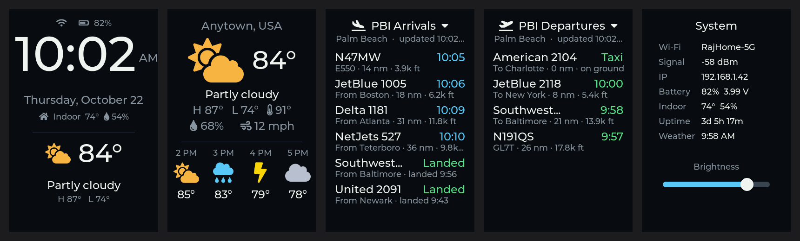

# DeskDash

DeskDash is a swipeable desk dashboard for the **[Waveshare ESP32-C5-Touch-LCD-3.5](https://www.waveshare.com/esp32-c5-touch-lcd-3.5.htm)**, a 320 × 480 touch display with an ESP32-C5 (dual-band Wi-Fi 6).



| Page | Shows |
|---|---|
| Clock | Time, date, Wi-Fi and battery status, indoor temperature and humidity, current weather |
| Weather | Conditions, high/low, feels-like, humidity, wind, next 4 hours |
| PBI Arrivals | Flights inbound to Palm Beach International (or any airport): airline and flight number, origin, distance, altitude and estimated arrival time |
| Trending on X | Top 10 trending topics in the US (or any location), with post counts when available |
| System | Wi-Fi name, signal, IP, battery, indoor reading, uptime, last weather update, brightness slider |

Swipe left or right to change pages. The screen dims between 10 PM and 7 AM, and a tap brightens it for 30 seconds.
Weather comes from [Open-Meteo](https://open-meteo.com), which is free and needs no API key. Time comes from NTP.
Live flight positions come from [adsb.lol](https://adsb.lol), a free community ADS-B network that needs no key. It allows about 500 requests per day per address, so DeskDash checks every 4 minutes by day and every 15 minutes at night. Flights count as arrivals when adsb.lol's route database says they're headed to the airport. Flights with no published route, such as private jets, count when they're descending toward the field on a normal approach path.
Trending topics are read from [trends24.in](https://trends24.in), a free, unofficial mirror of X's trends, every 30 minutes. It isn't an X API, so it can change or break without notice. The official [X API trends endpoint](https://docs.x.com/x-api/trends/trends-by-woeid/introduction) costs $0.01 per request.

## Hardware

- Waveshare ESP32-C5-Touch-LCD-3.5 (ST7796 display, FT6336 touch, CH32V006 I/O expander, AXP2101 power management, SHTC3 temperature/humidity sensor)
- A USB-C cable that carries data, plugged directly into the computer (not through a hub)
- Optional: a 3.7 V LiPo battery

## Setup (Arduino IDE)

1. **Board package:** install **esp32 by Espressif Systems**, version 3.3.x (Waveshare tests with 3.3.10).
2. **Library:** install **ArduinoJson 7.x** by Benoit Blanchon. LVGL 8.4 is bundled in `DeskDash/src/`, so it doesn't matter which lvgl version (if any) you have installed.
3. **Configure:** open `DeskDash/DeskDash.ino`, then set your Wi-Fi name and password, location, time zone, units and trends location in the `config.h` tab. The Wi-Fi name is case-sensitive. For trends, use the path from trends24.in, such as `united-states`, `united-states/miami`, or `""` for worldwide.
4. **Tools menu:**

   | Setting | Value |
   |---|---|
   | Board | ESP32C5 Dev Module |
   | USB CDC On Boot | Enabled |
   | Flash Size | 16MB (128Mb) |
   | Partition Scheme | 16M Flash (3MB APP/9.9MB FATFS) |
   | PSRAM | Enabled |
   | Port | `/dev/cu.usbmodem…` ("ESP32 Family Device") |

5. **Upload.** If the board isn't detected, hold **BOOT**, tap **RST**, and release **BOOT**.

Serial Monitor runs at 115200 baud. At boot the board scans for Wi-Fi networks and prints every network it can see, which helps track down a mistyped network name.

## Apple Silicon Macs

Arduino IDE's `ctags` helper is an Intel-only binary. If compiling fails with `bad CPU type in executable`, install Rosetta 2:

```
softwareupdate --install-rosetta --agree-to-license
```

## How it works

- **Display:** an ST7796 on SPI at 60 MHz, using `esp_lcd` panel IO with DMA. The init sequence comes from Waveshare's example.
- **LVGL 8.4:** LVGL runs in its own FreeRTOS task, with a mutex around every UI change. The draw buffers are two 40-line buffers in internal DMA-capable RAM. A full-screen buffer in PSRAM fails once Wi-Fi is running, because the SPI driver can't find internal memory to bounce it through. LVGL's object heap lives in PSRAM (`LV_MEM_CUSTOM`), which keeps about 64 KB of internal RAM free for Wi-Fi and TLS.
- **I2C (SDA 27, SCL 26):** all I2C traffic (touch, backlight PWM through the CH32V006, AXP2101 battery status, SHTC3) runs on the LVGL task, so the bus is never shared between threads.
- **Weather:** the board fetches weather over plain HTTP from Open-Meteo every 15 minutes.
- **Trends:** the trends24.in page is about 250 KB, so the board parses it as a stream over HTTPS. It takes the first `<ol class=trend-card__list>` (the latest hour) and reads each `trend-link` name and `data-count`. HTML entities are decoded, and characters the fonts can't draw are dropped. A topic written entirely in another script is skipped.
- **Fonts:** Montserrat and Font Awesome 5 glyphs, generated with [`lv_font_conv`](https://github.com/lvgl/lv_font_conv) at the sizes this screen needs.
- **Indoor sensor:** the SHTC3 sits on the board, so its temperature reading runs a few degrees warm from the board's own heat.

## Files

| File | Purpose |
|---|---|
| `DeskDash.ino` | UI, LVGL task, timers, Wi-Fi and weather |
| `config.h` | Your settings |
| `lcd_st7796.*` | Display init and pixel transfer |
| `Board_IO.*` | CH32V006 I/O expander: resets, backlight, peripheral power |
| `Touch_FT6336.*` | Touch controller |
| `sensors.*` | SHTC3 and AXP2101 drivers |
| `flights.*` | adsb.lol arrivals: aircraft near the airport, route lookups, arrival detection |
| `src/lvgl/`, `src/lv_conf.h` | Bundled LVGL 8.4.0 (MIT) and its configuration |
| `font_*.c` | Generated fonts |

## Credits and licenses

- The board drivers (`Board_IO.*`, `Touch_FT6336.*`, the ST7796 init sequence and `lv_conf.h`) are adapted from Waveshare's [ESP32-C5-Touch-LCD-3.5](https://github.com/waveshareteam/ESP32-C5-Touch-LCD-3.5) examples (Apache-2.0).
- The fonts are generated from Montserrat (SIL Open Font License) and Font Awesome Free 5 (icons CC BY 4.0, font SIL OFL), as bundled with LVGL.
- Weather data comes from [Open-Meteo](https://open-meteo.com) (CC BY 4.0). Flight data comes from [adsb.lol](https://adsb.lol) (ODbL). LVGL is MIT-licensed.
- DeskDash itself is released under the Apache License 2.0. See [LICENSE](LICENSE).
